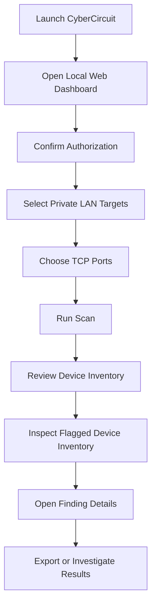

# ⚡ CyberCircuit Network Recon V5

  <strong>🔍 NETWORK VISIBILITY • DEVICE INTELLIGENCE • SECURITY INSIGHTS</strong>

  A cyber-style Windows network reconnaissance dashboard for understanding your network, inspecting reachable services, and reviewing security-relevant findings on devices you are authorized to assess.

  
  
  
  

---

## 📑 Table of Contents

1. [Overview](#-overview)
2. [Features](#-features)
3. [Dashboard Workflow](#-dashboard-workflow)
4. [Installation and Launch](#-installation-and-launch)
5. [Using the Dashboard](#-using-the-dashboard)
6. [Flagged Device Inventory](#-flagged-device-inventory)
7. [Build Lab](#-build-lab)
8. [Troubleshooting](#-troubleshooting)
9. [Security and Responsible Use](#-security-and-responsible-use)
10. [Version History](#-version-history)

---

## 🔍 Overview

**CyberCircuit Network Recon V5** is a local web-based network reconnaissance tool designed to help you understand devices and services on networks you own or have explicit permission to assess.

V5 adds a dedicated **Flagged Device Inventory** beneath the regular Device Inventory, making it easier to identify devices that deserve closer inspection while retaining the existing V4 dashboard features.

The interface runs locally on your Windows computer and is accessed through your web browser.

## 🚀 Features

| Feature | Description |
|---|---|
| 🖥️ Device Inventory | Review discovered devices and available host information. |
| 🚩 Flagged Device Inventory | Highlight devices with observations that may deserve attention. |
| 🔌 Port Scanning | Check selected TCP ports for reachability on authorized private LAN targets. |
| 🔎 Service Insights | Review available service labels and interpret observed results. |
| 🧠 Finding Details | Inspect evidence, explanations, limitations, and recommended follow-up checks. |
| 📊 Scan History | Review previous scan results where supported by the application. |
| 📤 Data Export | Export supported results in JSON and CSV formats. |
| 🧩 Reconnaissance Plugins | Use the included defensive network and host inspection modules. |
| 🐳 Docker Build Lab | Generate a harmless diagnostic CLI starter project for supported target platforms and architectures. |
| 🎨 Cyber GUI | Use the existing dark, cyber-inspired local web interface. |

> **Important:** An open port is not automatically a security vulnerability. Flags are review indicators based on observations, not proof that a device is compromised.

## 🗺️ Dashboard Workflow

## 💻 Installation and Launch

### Requirements

- Windows 10 or Windows 11.
- Python installed if it is not already available.
- A modern browser such as Microsoft Edge, Chrome, or Firefox.
- Docker Desktop if you want to use the optional Build Lab.

### Start the application

1. Download the project ZIP from the repository's **Releases** section, or use the project's ZIP download.
2. Extract the ZIP to a folder you can access.
3. Open the extracted `CyberCircuit-Network-Recon-V5` folder.
4. Double-click **`START-CyberCircuit.bat`**.
5. Open your browser and visit:

   **http://127.0.0.1:8765**

Keep the terminal window open while you use the dashboard. Close it when you want to stop the application.

## 🎛️ Using the Dashboard

### 1. Authorize the assessment

Only scan networks and devices that you own or have explicit permission to assess. Use the dashboard's permission confirmation before starting.

### 2. Select targets and ports

Choose an authorized private LAN range and the TCP ports you want to inspect. Keep your scan within the application's supported scope.

### 3. Review device information

Start with the regular Device Inventory to understand which devices were discovered and what information was observed.

### 4. Open individual findings

Select a finding to review the evidence, what it means, why it may matter, and suggested next steps. Treat service identification as best-effort unless the application provides stronger evidence.

## 🚩 Flagged Device Inventory

The dedicated Flagged Device Inventory appears **directly below the regular Device Inventory**.

It helps surface devices with observations that may need follow-up, including:

- Observed IP addresses and hostnames when available.
- Reachable TCP ports and associated service labels.
- Finding priority and reason for review.
- Scan evidence and timestamps where available.
- Suggested defensive checks and remediation guidance.

If nothing is flagged, that does not prove the network is secure. Review the normal inventory and informational findings as well.

## 🐳 Build Lab

The optional Docker Build Lab generates a starter project for a harmless diagnostic command-line program.

The generated example reports basic system metadata, such as the operating system, architecture, hostname, and runtime version.

Supported target selections depend on the generated project configuration. Docker is required for the container-based build workflow.

The Build Lab is separate from the network reconnaissance dashboard; it does not mean the application can successfully compile or run every possible platform target in every environment.

## 🧰 Troubleshooting

### The dashboard does not open

- Make sure the application is running.
- Visit `http://127.0.0.1:8765` exactly.
- Check whether another application is already using port `8765`.
- Review the terminal window for error messages.

### Python is not found

Install Python for Windows and ensure it is available to the launcher. Reopen the terminal or start the application again after installation.

### No devices are discovered

- Verify that you selected the correct private LAN range.
- Check that your computer is connected to the network.
- Remember that firewalls, Wi-Fi client isolation, and device sleep can affect discovery.
- Check that the devices are within the supported scan scope.

### A port appears open, but its service is unknown

Port numbers are only clues. Services can use nonstandard ports, and identifying a service accurately may require additional protocol-specific checks.

### Docker Build Lab fails

- Check that Docker Desktop is installed and running.
- Confirm that the requested target architecture is supported by the build configuration.
- Review the generated build output for errors.

## 🔐 Security and Responsible Use

CyberCircuit Network Recon is intended for authorized network visibility and defensive assessment.

- Only scan networks and devices you own or have explicit permission to assess.
- Keep the dashboard bound to the local machine unless you understand and intentionally configure a different access model.
- Do not treat a successful connection check as proof of a vulnerability.
- Validate important findings before making security decisions.
- Avoid scanning systems outside your authorized scope.

The application is a reconnaissance aid, not a guarantee of security or a replacement for a full professional security assessment.

## 📦 Version History

### V5
- Added a separate Flagged Device Inventory below Device Inventory.
- Added
